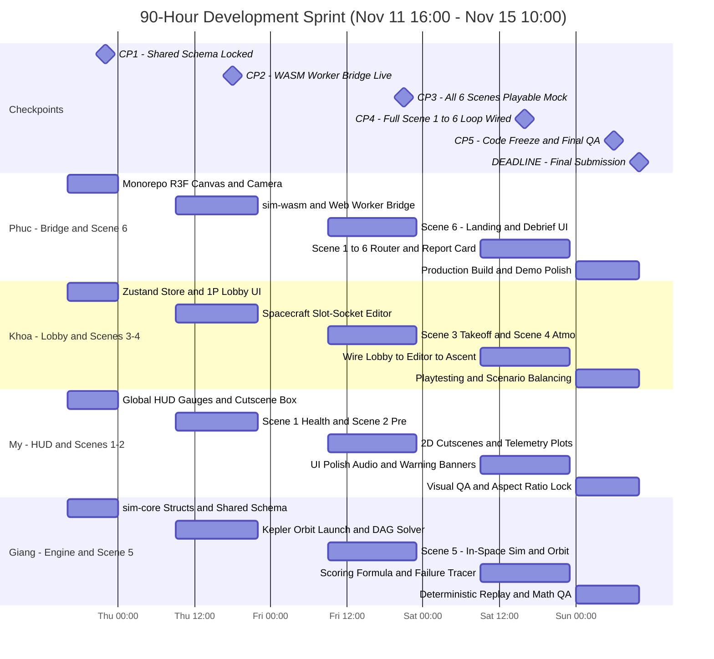

# SPRINT TIMELINE & TASK ALLOCATION PROMPT (90-HOUR SPRINT)

> **Context for AI Coding Agents & Team Members:**  
> This document defines the strict 90-hour development schedule from **Wednesday, Nov 11, 2026 (16:00)** to **Sunday, Nov 15, 2026 (10:00)** for building the **Space Mission Engineering Simulator**. When assisting a specific developer (Phúc, Khoa, My, or Giang), prioritize their assigned modules, scene ownership, and current sprint phase checkpoint.

---

## 1. Team Roster, Roles & Scene Ownership

Every team member owns **core architectural modules** plus **specific mission scenes** (covering all 6 required scenes across 4 developers):

| Developer | Primary Role & Architecture Ownership | Assigned Mission Scenes | Key Directories |
| :--- | :--- | :--- | :--- |
| **Phúc** | **Full-Stack Bridge, 2.5D Viewport & Integration Lead**<br>- Turborepo + Cargo workspace setup<br>- `sim-wasm` Web Worker bridge<br>- Three.js / R3F 2.5D viewport & camera<br>- Post-Mission Analysis & Causal Failure Report | **Scene 6:** `SCENE_6_LANDING_AND_DEBRIEF`<br>*(De-orbit, 2.5D Terrain Descent, Landing & Final Evaluation)* | `crates/sim-wasm/`<br>`apps/web/src/components/viewport/`<br>`apps/web/src/workers/`<br>`apps/web/src/components/scenes/Scene6Landing.tsx` |
| **Khoa** | **Session State, Single-Player Lobby & Ascent Lead**<br>- 1-player lobby & mission scenario selector<br>- Zustand `missionStore` & JSON save/load<br>- Modular spacecraft bus & slot-socket editor<br>- Random flight anomaly triggers | **Scene 3:** `SCENE_3_TAKEOFF_CHECK`<br>**Scene 4:** `SCENE_4_ATMOSPHERIC_ESCAPE`<br>*(Ignition, Liftoff, $\text{Max-}Q$, Stage Separation)* | `apps/web/src/stores/`<br>`apps/web/src/components/editor/`<br>`apps/web/src/components/scenes/Scene3Takeoff.tsx`<br>`apps/web/src/components/scenes/Scene4AtmosphericEscape.tsx` |
| **My** | **Frontend UI, HUD Dashboards & 2D Cutscene Lead**<br>- Global sci-fi HUD shell & resource gauges<br>- 2D high-DPI pixel cutscene player & dialogue overlay<br>- Real-time telemetry charts (`uPlot`) | **Scene 1:** `SCENE_1_HEALTH_CHECK`<br>**Scene 2:** `SCENE_2_PREFLIGHT_CHECK`<br>*(Component Diagnostics, Power/Mass Checks, Booster Compatibility)* | `apps/web/src/components/ui/`<br>`apps/web/src/components/dashboard/`<br>`apps/web/src/components/cutscene/`<br>`apps/web/src/components/scenes/Scene1HealthCheck.tsx`<br>`apps/web/src/components/scenes/Scene2PreflightCheck.tsx` |
| **Giang** | **Core Rust Simulation Engine & Orbital Physics Lead**<br>- `crates/sim-core` deterministic architecture<br>- Keplerian orbital math, $J_2$, eclipse & ground-station LOS<br>- Continuous DAG resource solver (Power, Data, Mass, Budget)<br>- Multi-metric scoring & failure trace logic | **Scene 5:** `SCENE_5_IN_SPACE`<br>*(Orbital Trajectory Propagation, Eclipse Battery Drain, Ground Downlink)* | `crates/sim-core/`<br>`packages/shared-schema/`<br>`apps/web/src/components/scenes/Scene5InSpace.tsx` |

---

## 2. Gantt Chart (Nov 11, 16:00 $\rightarrow$ Nov 15, 10:00)



---

## 3. Phase-by-Phase Execution Plan

### Phase 1: Foundation & Data Contracts
**Window:** Wednesday, Nov 11 (16:00 – 24:00)  
**Goal:** Initialize repository, lock the TypeScript/Rust JSON contract, and render the base `<SceneLayout>` wrapper.

* **Phúc:**
  * Initialize `pnpm` + Turborepo + Cargo workspace (`crates/sim-core`, `crates/sim-wasm`, `apps/web`, `packages/shared-schema`).
  * Create `<WorldCanvas>` with Three.js / R3F fixed-pitch orthographic camera ($\approx 26.565^\circ$) and `<SceneLayout>` container.
* **Khoa:**
  * Implement `missionStore.ts` in Zustand holding `MissionDesignConfig`, current `SceneId`, and mocked `TelemetryTick` stream.
  * Build the 1-Player Lobby screen (mission objective selection, difficulty selector, Sandbox toggle).
* **My:**
  * Build the global `<TelemetryHUD>` overlay (Mass, Power, Battery, Data buffer, Budget bars) and `<DialogueOverlay>` for 2D cutscenes.
* **Giang:**
  * Author `packages/shared-schema` and mirror the exact structs in `crates/sim-core/src/lib.rs` with `serde`.
  * Define baseline component catalog JSON (solar arrays, batteries, antennas, sensors, launch vehicles).

---

### Phase 2: Core Pipeline & Pre-Launch Scenes
**Window:** Thursday, Nov 12 (09:00 – 22:00)  
**Goal:** Establish live Rust-to-WASM Web Worker execution and complete the Spacecraft Editor + Scenes 1 & 2.

* **Phúc:**
  * Expose `sim-core` functions via `wasm-bindgen` in `crates/sim-wasm`.
  * Build `simulation.worker.ts` and `useSimulationWasm.ts` hook so React components can run simulations off the main thread.
* **Khoa:**
  * Build the Spacecraft Assembly Editor (`<BusSocketGrid>` and `<ComponentDrawer>`), updating `MissionDesignConfig` in real time.
  * Add JSON export/import so players can save and share mission designs.
* **My:**
  * Build **Scene 1 (`Scene1HealthCheck.tsx`):** Interactive spacecraft bus diagnostic screen checking power balance, mass limits, and missing mandatory subsystems.
  * Build **Scene 2 (`Scene2PreflightCheck.tsx`):** Launch vehicle compatibility verifier checking wet mass vs. orbital altitude/inclination capability curves.
* **Giang:**
  * Implement `kepler.rs` (orbital period, velocity, eclipse duration, ground-station LOS windows).
  * Implement `launch.rs` (payload mass vs. orbit envelope validator) and `resource_graph.rs` (discrete $\Delta t$ power and data buffer loop).

---

### Phase 3: Flight, Space & Landing Scenes (Scenes 3, 4, 5, 6)
**Window:** Friday, Nov 13 (09:00 – 23:00)  
**Goal:** Build and test all remaining mission scenes in isolation using standardized `SceneProps`.

* **Phúc:**
  * Build **Scene 6 (`Scene6Landing.tsx`):** Entry, descent, and landing visualization over a 2.5D billboard terrain viewport.
  * Build the `<PostMissionReport>` modal displaying final score breakdown and `<CausalFailureCard>` diagnostics.
* **Khoa:**
  * Build **Scene 3 (`Scene3Takeoff.tsx`):** Launchpad countdown, ignition telemetry, thrust-to-weight check, and liftoff camera shake/particles.
  * Build **Scene 4 (`Scene4AtmosphericEscape.tsx`):** Multi-layer vertical parallax sky transition, $\text{Max-}Q$ structural stress gauge, fairing separation, and stage burn.
* **My:**
  * Build 2D cutscene transitions between scenes and integrate `uPlot` real-time graphs for battery depth-of-discharge and data downlink bursts.
* **Giang:**
  * Build **Scene 5 (`Scene5InSpace.tsx`):** Orbital trajectory visualizer, eclipse shadow pass indicator, ground station downlink indicator, and live science point accumulation.

---

### Phase 4: End-to-End Integration & Balancing
**Window:** Saturday, Nov 14 (09:00 – 23:00)  
**Goal:** Connect the full game loop from Lobby $\rightarrow$ Editor $\rightarrow$ Scene 1 $\rightarrow$ Scene 2 $\rightarrow$ Scene 3 $\rightarrow$ Scene 4 $\rightarrow$ Scene 5 $\rightarrow$ Scene 6 $\rightarrow$ Debrief Report.

* **Phúc:**
  * Wire the master scene state router (`useSceneRouter`) to transition smoothly across all 6 scenes using live WASM telemetry ticks.
  * Connect mid-flight failure triggers so any fatal anomaly halts the flight and opens the Causal Failure Tracer.
* **Khoa:**
  * Connect Lobby scenario presets (Easy, Normal, Hard, Sandbox) into the editor and tune random mission events (e.g., solar storms, transponder degradation).
* **My:**
  * Polish HUD transitions, warning banners, sound effects / BGM triggers, and cutscene skip/advance controls across all 6 scenes.
* **Giang:**
  * Tune `evaluator.rs` scoring weights:
    $$\text{Score} = w_1(\text{Science}) + w_2(\text{Efficiency}) - w_3(\text{Budget Overrun}) - w_4(\text{Risk})$$
  * Verify all causal failure chains generate clear, educational recommendations.

---

### Phase 5: Code Freeze, QA & Submission
**Window:** Sunday, Nov 15 (00:00 – 10:00)  
**Goal:** Feature freeze at 06:00, bug triage, production build verification, and submission before 10:00.

* **00:00 – 06:00:** Full playthrough testing across all difficulty modes and mission objectives; fix state edge cases and UI overflow bugs.
* **06:00 – 08:30:** **HARD CODE FREEZE.** Run `pnpm build` (Next.js static/production build + pre-compiled WASM binary verification).
* **08:30 – 10:00:** Package final submission, record backup gameplay video, and submit.

---

## 4. Instructions for AI Coding Agents Using This Timeline

1. **Identify the Active Developer & Scene:** When prompted by a user, check which developer they are or which scene/module they are working on, and scope file edits strictly to their assigned directories to avoid merge conflicts.
2. **Respect Checkpoint Mocking:** If the WASM bridge is not yet merged, always provide a fallback mock `TelemetryTick` generator so frontend scenes (`Scene1` through `Scene6`) can be rendered and tested standalone.
3. **Enforce `SceneProps` Consistency:** Every scene component in `apps/web/src/components/scenes/` must implement:
   ```typescript
   export interface SceneProps {
     config: MissionDesignConfig;
     currentTick: TelemetryTick;
     failureTrace: CausalFailureTrace | null;
     onAdvanceScene: () => void;
     onAbortMission: (reason: CausalFailureTrace) => void;
   }
   ```